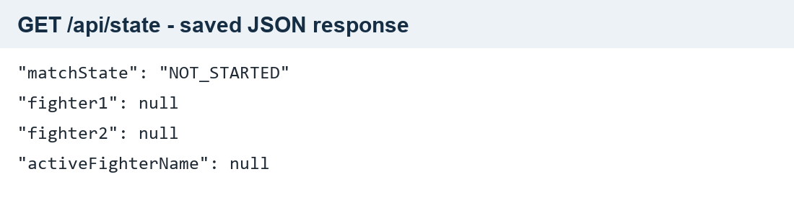
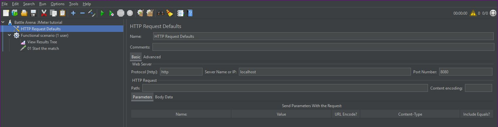
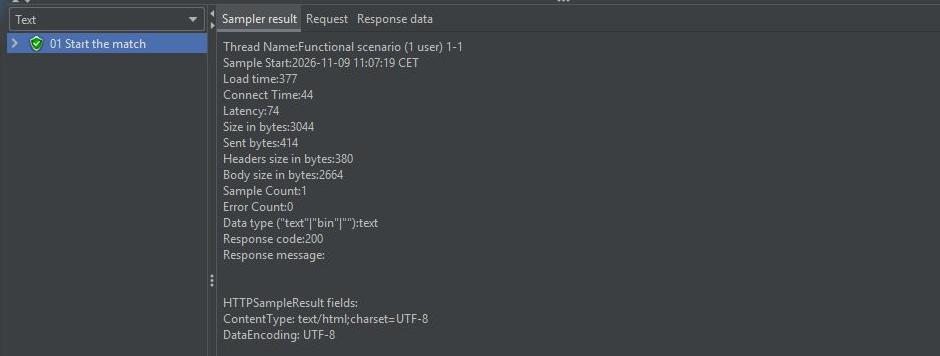
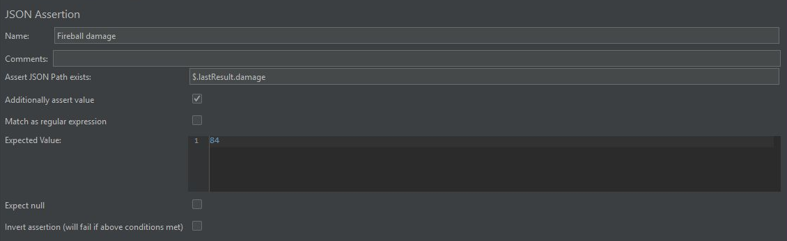
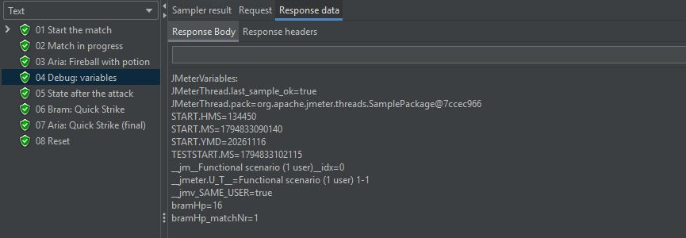
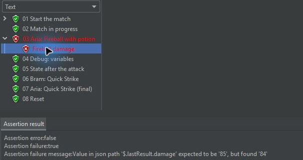
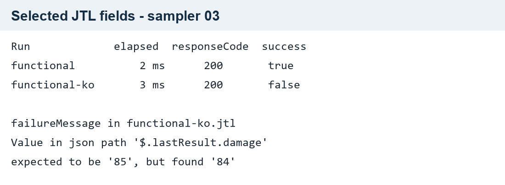
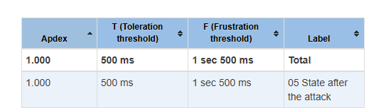
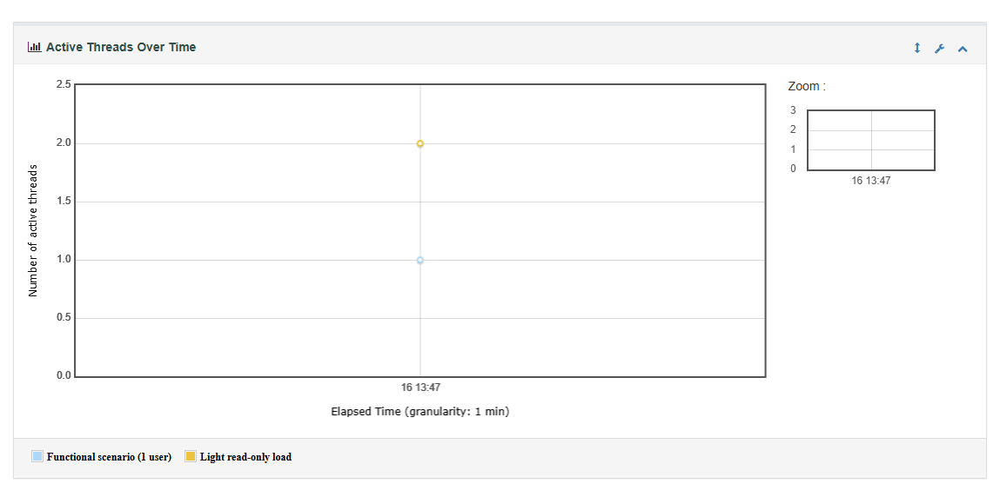

# JMeter tutorial

Completed on 2026-11-16. JDK 17.0.18 and Apache JMeter 5.6.3.

The plan is at `battle-arena/jmeter/battle-arena-tutorial.jmx`. It runs against Battle Arena on localhost:8080. Start the app before JMeter.

## Step 1 - The API and TC-J1

We started the same Battle Arena project with JDK 17 and mvnw.cmd spring-boot:run. GET /api/state returned NOT_STARTED. Both fighters were null.

TC-J1 uses Aria, a Mage with power 40, and Bram, a Rogue with power 45. Aria uses Fireball with a potion.

Expected damage = (30 + 40) x (1 + 10% + 10%) = 84. Bram should have 16 HP. Aria should have 75 mana. Bram should play next.

JMeter calls the running application through HTTP. The functional plan uses one user because all clients share one match.

Figure 1. Selected fields from the saved initial JSON response.

## Step 2 - Install JMeter and create the plan

We downloaded the JMeter 5.6.3 binary ZIP from Apache and checked its SHA-512 checksum. jmeter.bat -v printed version 5.6.3. The installation is outside the project.

We saved jmeter/battle-arena-tutorial.jmx next to src and pom.xml. HTTP Request Defaults sets localhost and port 8080.

The functional Thread Group has 1 user, a 1-second ramp-up and 1 loop. View Results Tree shows the requests and answers.

The tree holds the test elements. The panel on the right edits the selected element. Start runs the plan, and Clear All removes old listener results.

Figure 2. JMeter window and the shared HTTP address.

## Step 3 - Add the requests

We first ran 01 Start the match with the six form fields. JMeter followed the 302 redirect to /battle and showed a final 200 response. The first run took 377 ms.

We then added GET state, Aria's Fireball, Debug Sampler, GET state, Bram's Quick Strike, Aria's final Quick Strike and Reset. The completed plan has eight samplers, including Debug Sampler.

The Request tab shows what was sent. Response data shows the HTML or JSON answer. Sampler result shows the HTTP code and time.

J1. Only the three attack requests use Content-Type application/json. /start sends a form. When the JSON header was placed on the whole group, /start returned 400.

Figure 3. The first start request returned 200 after the redirect.

## Step 4 - Add assertions

We added a response-code assertion and a text check to the start request. The text check looks for fighter2-hp-value in the battle page.

The state checks cover IN_PROGRESS, Mage and 100 HP. The Fireball request checks HTTP 200, damage 84, Bram HP 16 and Aria mana 75.

The later checks cover Bram's turn, IN_PROGRESS after his attack, then VICTORY and winner Aria. Reset must return NOT_STARTED.

J2. Damage 84 checks the attack rule. The other three checks cover HTTP success and its effects on HP and mana. If damage is 84 but mana stays at 100, the mana assertion fails.

Figure 4. JSON Assertion checks $.lastResult.damage against 84.

## Step 5 - Extract and reuse Bram's HP

We added a JSON Extractor under the Fireball request. It reads $.fighter2.hp into bramHp, with match number 1 and default NOT_FOUND.

The Debug Sampler is between the attack and the next state request. Its Response data shows bramHp=16 and bramHp_matchNr=1.

The next GET /api/state uses ${bramHp} as the expected HP. It passed, so the later state agrees with the attack response.

The fixed value 16 in step 4 checks the rule. Reusing bramHp checks that two responses agree. If extraction fails, NOT_FOUND makes the problem visible.

Figure 5. All eight samplers passed, and the extracted HP is 16.

## Step 6 - Fail on purpose and test clean-up

The first complete GUI run passed. We changed only the expected damage from 84 to 85. Sampler 03 turned red and reported expected 85, found 84.

The HTTP 200, HP 16 and mana 75 assertions still passed. Samplers 04 to 08 also ran. The Thread Group uses Continue after a sampler error.

We restored 84. Two more runs passed without restarting the app.

J3. With Reset disabled, the first run passed. The second start returned HTTP 500 because the previous match was still VICTORY. We enabled Reset again.

Optional observation. A second start during a match returned 500, but the names changed from Aria/Bram to Zed/Yan. This is a separate candidate defect.

Figure 6. The failed assertion names the JSON path and the two values.

## Step 7 - Command line and JTL files

We ran the functional plan with -n, -t, -l, -e and -o. These select command-line mode, the plan, the result file and the HTML report. Each run used a new output name.

The console counted 8 samplers with 0 errors. In this installation, the CSV also records two redirect sub-results from sampler 01, so the JTL and dashboard contain 10 rows.

J4. Sampler 03 took 2 ms, returned 200 and had success=true. With expected damage 85, it took 3 ms, still returned 200, but had success=false.

The failureMessage column says which JSON path differed. A 200 response can fail an assertion. The correct expected value is restored to 84.

Figure 7. Selected fields rendered from the actual good and failed JTL files.

## Step 8 - Read the HTML report

The functional dashboard shows Apdex 1.000 and 100% PASS. The default thresholds are 500 ms and 1500 ms. Statistics shows 10 saved rows, 0 errors, average 10.40 ms and maximum 45 ms.

The failed dashboard shows 1 error out of 10 saved rows, or 10%. Its Errors table repeats expected 85, found 84. The console shows 1 of 8 samplers, or 12.5%, because it counts the parent samplers.

J5. 01 Start the match has the highest maximum, 45 ms. It is the first request. Opening a connection and rendering the HTML page can add time. Eight samplers give too little data to judge performance.

Average, percentiles and throughput answer different questions. Throughput is requests per second. A 95th percentile describes the time reached by about 95% of samples. These short local results mainly help us learn the report.

Figure 8. The functional dashboard's Apdex table.

## Step 9 - A light read-only load

We added Light read-only load with 10 users, a 5-second ramp-up and 20 loops. It sends GET /api/state and checks HTTP 200. Thread groups run consecutively.

The console counted 208 samplers with 0 errors. The JTL and dashboard contain 210 rows because of the two redirect sub-results.

Read the state has 200 samples, 0 errors, average 1.53 ms, 95th percentile 3 ms and throughput 44.11/s. The raw allThreads maximum is 1. Users finish their short loops before the next user starts. The chart groups both thread groups into one 1-minute bucket.

J6. Reading leaves the shared match intact. Concurrent attacks would use the same turn and fighters. Separate matches per user would be needed to test independent attack journeys.

These results come from a few seconds on one computer. Sources are JMeter_Tutorial_Student.pdf and the Apache JMeter manual. Work ran in two sessions, on 9 and 16 November. Separate step times were not tracked.

Figure 9. The default chart groups this short run into a single time bucket.

## Run files

The generated files are local under `battle-arena/target/jmeter`. They are excluded from Git.

| File | Use |
| --- | --- |
| `functional.jtl` and `functional-report/` | Correct functional run |
| `functional-ko.jtl` and `functional-ko-report/` | Expected damage 85, one failed parent sampler |
| `light-load.jtl` and `light-load-report/` | Functional scenario followed by 200 reads |
| `restored-1.jtl` and `restored-2.jtl` | Two passing runs after restoring 84 |
| `no-reset-1.jtl` and `no-reset-2.jtl` | Clean-up experiment |
| `step-06.xml` and `step-06-wrong.xml` | GUI responses and assertion details |

The console counts 8 functional samplers or 208 samplers with the read group. The saved CSV adds the two redirect sub-results. Its counts are 10 and 210. In the failed functional run, 1/8 is 12.5% in the console and 1/10 is 10% in the dashboard.

The short load run has 200 successful reads. Its raw maximum `allThreads` is 1. The chart combines the two thread groups in the same one-minute bucket, so its plotted group counts should not be read as ten concurrent users.

The work was interrupted between 9 and 16 November. Separate step times were not tracked. The JTL timestamps and elapsed fields record the actual request timings.

## Sources

- Course handout, `JMeter_Tutorial_Student.pdf`, pages 1-13.
- [Apache JMeter download](https://jmeter.apache.org/download_jmeter.cgi).
- [Apache JMeter dashboard manual](https://jmeter.apache.org/usermanual/generating-dashboard.html).
- [Google Docs report](https://docs.google.com/document/d/1HzdIst1yTTkMrh4jc-bvMok-zqacpNQwLi7KX1cxrRM/edit).
