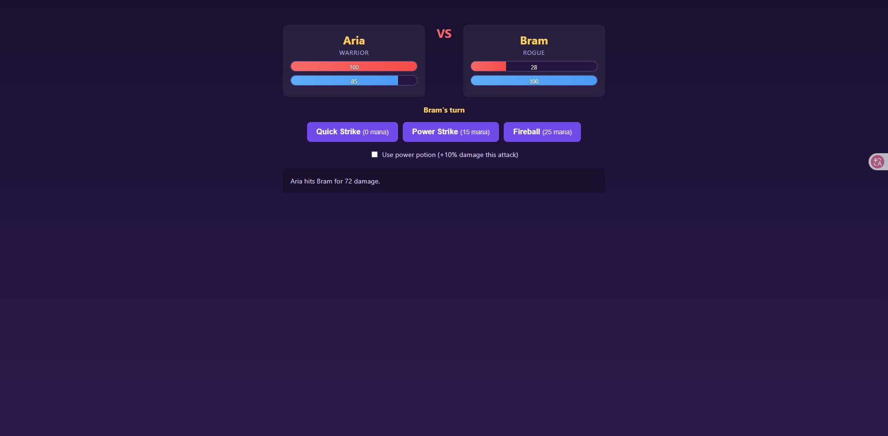

# Playwright tutorial: step 1

Date: 2026-11-02

## Existing tests

From `battle-arena`, run:

```powershell
.\mvnw.cmd test
```

Result: **46 tests, 9 failures, 0 errors, 0 skipped**. This matches the TD3a result. The nine failures find the bugs left in the app for the course. They are our starting point for later checks.

This run used Java 17.0.18. Maven reported a total time of 4.774 seconds.

## TC-P1: Warrior with a power potion

Start the app with `.\mvnw.cmd spring-boot:run`, then open http://localhost:8080.

1. Keep Aria as Warrior and set her attack power to 40.
2. Keep Bram as Rogue with attack power 45.
3. Start the battle.
4. Tick the power potion box and click Power Strike.

Expected damage, from the rules:

```text
Base damage = 20 + 40 = 60
Bonus = 15% + 10% = 25%, capped at 20%
Damage = 60 x 1.20 = 72
Bram HP = 100 - 72 = 28
Aria mana = 100 - 15 = 85
```

| Check | Expected | Seen on the page |
| --- | --- | --- |
| Bram HP | 28 | 28 |
| Battle log | Aria hits Bram for 72 damage. | Aria hits Bram for 72 damage. |
| Aria mana | 85 | 85 |
| Potion box | Unticked | Unticked |
| Turn | Bram's turn | Bram's turn |

All five checks passed. The values were worked out from the rules before checking the page. No Playwright test code or dependency has been added yet.



## Local start issue

The first app start failed with `Unable to establish loopback connection`. It started after setting a short folder for Java's local socket files for that run:

```powershell
New-Item -ItemType Directory -Path 'D:\Downloads\td3-java-tmp' -Force
.\mvnw.cmd spring-boot:run '-Dspring-boot.run.jvmArguments=-Djdk.net.unixdomain.tmpdir=D:/Downloads/td3-java-tmp'
```

This only changes the launch command. No application code or system setting was changed. See the [Java networking guide](https://docs.oracle.com/en/java/javase/17/core/java-networking.html) for this property.

## Time

Elapsed time for starting the app, playing TC-P1 and rerunning the unit tests: **1 minute 50 seconds** (10:58:05 to 10:59:55, Paris time). This includes the failed start and retry. It excludes the earlier workbook comparison and README update.

The next step is to write `FirstStepsTest`, see the missing-library error, then add Playwright to the POM.
