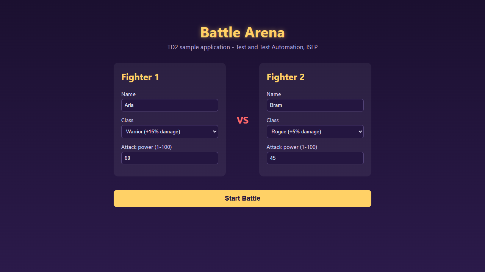

# Playwright tutorial: step 3

Date: 2026-11-02. Java: 17.0.18. Playwright: 1.63.0.

## 1. Run the first browser test

With the app running on port 8080, ran this from `battle-arena`:

```powershell
.\mvnw.cmd test -Dtest=FirstStepsTest
```

The first run downloaded the browsers. Result: **1 test, 0 failures, 0 errors, 0 skipped** and **BUILD SUCCESS**. Maven reported 1 minute 15 seconds, including the download.

The `-Dtest` option selects one class. This keeps the nine expected unit-test failures out of this run.

## 2. Watch Chromium

For one run, added the `BrowserType` import and changed the launch call to:

```java
Browser browser = playwright.chromium().launch(new BrowserType.LaunchOptions()
        .setHeadless(false).setSlowMo(1000));
```

`setHeadless(false)` shows a browser window. `setSlowMo(1000)` adds a one-second delay to browser actions, so the steps are easier to watch.

This run also passed. A temporary screenshot call saved the page after the title check. Then we removed that call and the `BrowserType` import, and restored `launch()` with no options.



## 3. Read the check

```java
page.navigate("http://localhost:8080");
assertThat(page.locator("h1")).hasText("Battle Arena");
```

`navigate` opens the page and waits for it to load. `locator("h1")` describes how to find the heading. `hasText` checks the full text and retries until it matches or the timeout ends. This `assertThat` comes from Playwright.

The `try (...)` block closes Playwright even if a check fails. We do not catch the error here, because JUnit needs it to report the test result.

## 4. Failure A: wrong title

Temporarily changed the expected text to `Battle Arena 2` and ran the same test command.

The output said:

```text
Locator expected to have text
Expected: Battle Arena 2
Received: Battle Arena

Call log:
  - Assert "hasText" locator("h1") with timeout 5000ms
  - waiting for locator("h1")
    13 x locator resolved to <h1>Battle Arena</h1>
       - unexpected value "Battle Arena"
```

Result: **1 test, 1 failure, 0 errors**. The test method took 8.691 seconds, including browser setup and the five-second assertion timeout. The page was there, but its title did not match our expected text. In this experiment, our expected text was wrong.

Restored the correct text, `Battle Arena`.

## 5. Failure B: app stopped

Stopped the local Battle Arena app, then ran the test again with the correct expected title.

The output included:

```text
com.microsoft.playwright.PlaywrightException
net::ERR_CONNECTION_REFUSED at http://localhost:8080/
navigating to "http://localhost:8080/", waiting until "load"
```

Result: **1 test, 0 failures, 1 error**. The test method took 3.535 seconds, including browser setup. It stopped at `page.navigate`, before the title check. There was no server to open the page.

## P3: Why do these failures take different amounts of time?

In A, Playwright found the page and kept checking the title for up to five seconds. In B, the connection was refused before the title check could run, so there was no five-second assertion wait. The full test still takes a few seconds to start and close the browser.

A means we must compare the expected text with the page and the rules. B means we must first start the app or check its address.

## 6. Restore and check

Restarted the app with the same local launch option used in [step 1](playwright-step-1.md#local-start-issue), then ran `FirstStepsTest` again. It passed. All temporary edits were removed; the test file is the same as at the end of step 2.

| Run | Tests | Failures | Errors | Class time (seconds) | Maven result |
| --- | --- | --- | --- | --- | --- |
| First run, with browser download | 1 | 0 | 0 | 70.520 | BUILD SUCCESS |
| Visible browser with slow actions | 1 | 0 | 0 | 7.671 | BUILD SUCCESS |
| Wrong title | 1 | 1 | 0 | 8.741 | BUILD FAILURE |
| App stopped | 1 | 0 | 1 | 3.594 | BUILD FAILURE |
| Correct title, app restarted | 1 | 0 | 0 | 3.907 | BUILD SUCCESS |

Skipped tests: 0 in every run. Class time includes setup and cleanup; it is not just the time spent on the failed action. The final Maven run took 8.091 seconds.

The app is running again. No application source, unit test or workbook was changed. The raw run logs remain under `battle-arena/target`, which is not uploaded.

## Time

Work time before the final save and push: **4 minutes 42 seconds** (11:17:34 to 11:22:16, Paris time). This includes the browser download, five test runs, restarting the app and writing these notes.

Next: add the two support classes. They will start the app on a free port, reset the match, create a fresh browser context for each test and save traces.
