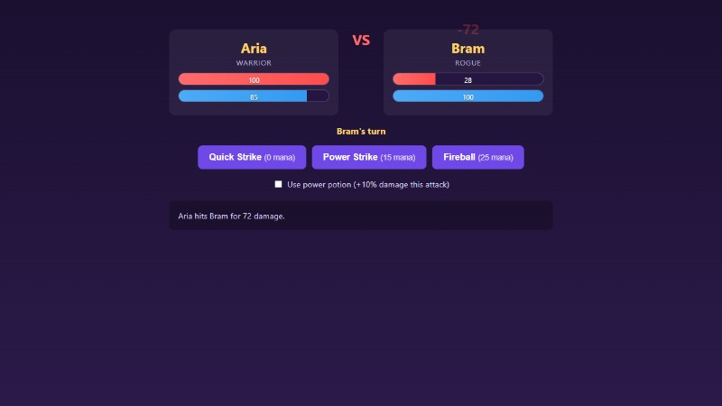

# Playwright tutorial: step 5

Date: 2026-11-02. Java: 17.0.18. Playwright: 1.63.0.

Added [`PlaywrightTutorialTest.java`](../battle-arena/src/test/java/com/isep/battlearena/tutorial/PlaywrightTutorialTest.java). It extends `UiTestBase`, so the app, browser, clean match and trace are prepared by the base class. No app was started by hand for these runs.

## 1. Check the setup page

The first test opens `baseUrl`, checks the `Battle Arena` heading and checks that the Start Battle button is visible.

```powershell
.\mvnw.cmd test -Dtest=PlaywrightTutorialTest
```

Result: **1 test, 0 failures, 0 errors**. The app started on port 62842. A trace was saved for the test.

## 2. Fill the form and click Start Battle

Added TC-P1, first with only its arrange part:

```java
page.navigate(baseUrl);
page.locator("select[name='f1Class']").selectOption("WARRIOR");
page.locator("input[name='f1AttackPower']").fill("40");
page.locator("button.btn-start").click();
page.waitForURL("**/battle");
```

Aria is Warrior with attack power 40. Bram keeps the default values: Rogue with power 45.

Ran only this method, with a visible browser and slower actions:

```powershell
.\mvnw.cmd test '-Dtest=PlaywrightTutorialTest#aWarriorUsingAPotionIsCappedAtTwentyPercent' -Dheadless=false -Dslowmo=500
```

The form was filled and the browser moved to the battle page. This run passed, but at this stage it only showed that the journey could run without an error. It did not check the damage yet.

## 3. Click the potion and attack

Added:

```java
page.locator("#use-potion-checkbox").check();
page.locator("#attack-power").click();
assertThat(page.locator("#fighter2-hp-value")).hasText("28");
```

`check()` ticks the page's checkbox. `click()` clicks the page's Power Strike button. The browser sends the attack request and the page updates from the response. The test does not send the attack through the API helper.

The expected value comes from the rules:

```text
Base = 20 + 40 = 60
Bonus = 15% + 10% = 25%, capped at 20%
Damage = 60 x 1.20 = 72
Bram HP = 100 - 72 = 28
Aria mana = 100 - 15 = 85
```

Ran the single method again without the visible-browser options. It passed the HP check. The assertion waits for the updated value, so no fixed sleep is needed.

## 4. Check the other results

Added four more checks for the same attack, then ran the whole class with `-Dheadless=false -Dslowmo=500`.

| Check | Locator | Expected result |
| --- | --- | --- |
| Bram HP | `#fighter2-hp-value` | `28` |
| Battle log | `#battle-log` | Contains `Aria hits Bram for 72 damage.` |
| Aria mana | `#fighter1-mana-value` | `85` |
| Potion box | `#use-potion-checkbox` | Not checked |
| Turn | `#active-fighter-indicator` | `Bram's turn` |

The HP check comes first because it checks the cap rule. `hasText` checks the whole text, while `containsText` allows other lines in the log. `not().isChecked()` waits for the box to become unticked. If a check fails, the rest of that test method stops.

These checks belong to one journey. A second `@Test` method checks the setup page on its own.

## Page locators

| Element | Locator |
| --- | --- |
| Aria's class | `select[name='f1Class']` |
| Aria's attack power | `input[name='f1AttackPower']` |
| Start button | `button.btn-start` |
| Potion box | `#use-potion-checkbox` |
| Power Strike button | `#attack-power` |

These names and IDs already exist in the app. No page markup was changed. `#` selects an ID; `.btn-start` selects a CSS class. We did not use long paths tied to the page layout.

## Results

| Stage | Tests | Failures | Errors | Port | Maven time |
| --- | --- | --- | --- | --- | --- |
| Setup page only | 1 | 0 | 0 | 62842 | 20.655 s |
| Arrange only, visible browser | 1 | 0 | 0 | 64830 | 21.550 s |
| Attack and HP check | 1 | 0 | 0 | 53363 | 18.338 s |
| Full class, visible browser | 2 | 0 | 0 | 56255 | 25.243 s |

Skipped tests: 0 in every run. All four runs ended with `BUILD SUCCESS`. The full class took 18.42 seconds inside JUnit, including setup and cleanup. Each run started its own app on a free port.

Also reran the service unit tests: **46 tests, 9 failures, 0 errors, 0 skipped**, matching the old baseline. Their Maven run took 4.593 seconds and returned exit code 1 for the known failures.

No application source, old unit test, support class, POM or workbook was changed.

## Saved result

The base class saved one trace per test in `battle-arena/target/traces`. The TC-P1 trace records the form input, Start Battle click, potion check, Power Strike click and five assertions.

An archive copy is saved as [the TC-P1 trace](playwright-step-5-tc-p1.zip). The image below is the last page screenshot from that trace, copied without changes.



## P5: Which check finds each bug?

If the cap is missing and the attack deals 75 damage, Bram has 25 HP. The first HP assertion fails because it expects 28.

If the cap works and Bram has 28 HP, but the log says 75 damage, the HP assertion passes and the log assertion fails.

A log-only test could miss a wrong HP value when the log itself still says the expected number. Checking both helps show whether the page state and the message agree.

## Local Java option

This machine needed the short socket folder used in step 1. Before each Maven command, set this only for that command's PowerShell process:

```powershell
$env:JAVA_TOOL_OPTIONS = (($env:JAVA_TOOL_OPTIONS + ' -Duser.language=en -Duser.country=US -Dfile.encoding=UTF-8 -Djdk.net.unixdomain.tmpdir=D:/Downloads/td3-java-tmp').Trim())
```

This gives the Maven JVM and test JVM the same setting. It is not stored in the POM or system settings. The English options keep the run output in English.

## Time

Work time before the final save and push: **4 minutes 31 seconds** (11:59:17 to 12:03:48, Paris time). This includes the four UI runs, the unit-test check, saving the trace and screenshot, and writing these notes.

Next: read the passing report, make the HP assertion fail on purpose, and inspect the trace.
