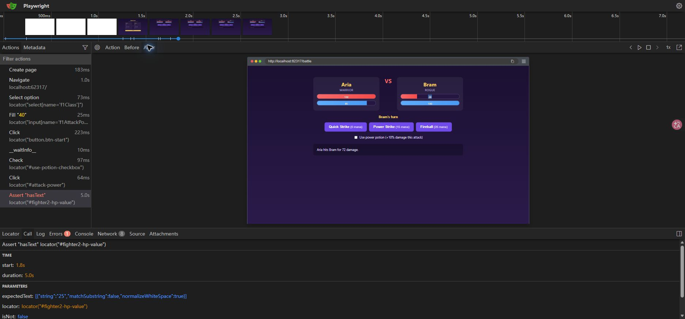
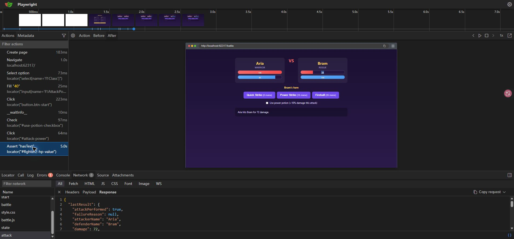
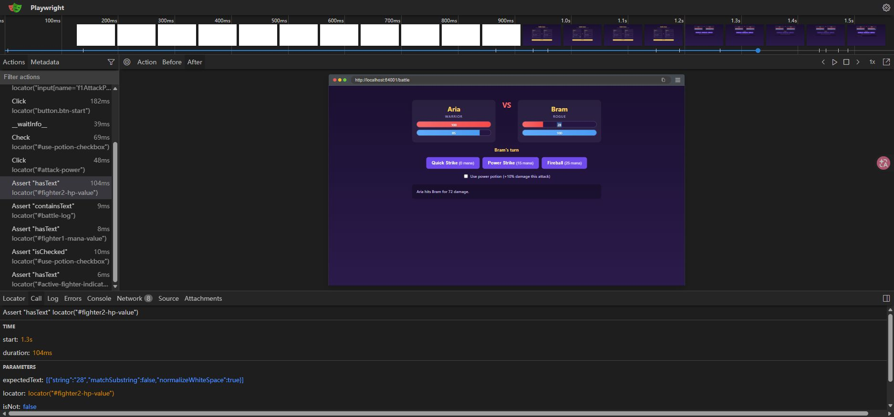

# Playwright tutorial: step 6

Date: 2026-11-02. Java: 17.0.18. Playwright: 1.63.0.

## 1. Make the HP check fail

Temporarily changed line 32 of `PlaywrightTutorialTest.java`:

```java
assertThat(page.locator("#fighter2-hp-value")).hasText("25");
```

Ran only TC-P1 from `battle-arena`:

```powershell
.\mvnw.cmd test '-Dtest=PlaywrightTutorialTest#aWarriorUsingAPotionIsCappedAtTwentyPercent'
```

The app started on port 62317. Result: **1 test, 1 failure, 0 errors, 0 skipped**, exit code 1 and `BUILD FAILURE`. Maven took 28.247 seconds. The JUnit class time was 21.00 seconds; the test method time was 10.21 seconds.

## 2. Read the report

The console and the text report both identified `aWarriorUsingAPotionIsCappedAtTwentyPercent`, line 32.

```text
Locator expected to have text
Expected: 25
Received: 28

Call log:
  - Assert "hasText" locator("#fighter2-hp-value") with timeout 5000ms
  - waiting for locator("#fighter2-hp-value")
```

The rest of the log showed two reads of HP 100, then twelve reads of HP 28. The page updated after the attack, but it never showed 25.

This is a **Failure**, because an assertion did not match. It is not an Error caused by a missing server or a browser that could not start.

Maven writes the reports under `target/surefire-reports`: a text file for reading and an XML file for tools such as a build server. Saved the [failed text report](playwright-step-6-failure.txt) before the next run could replace it.

## 3. Open the failed trace

The base class saved the trace even though the assertion failed. Copied it to [the failed trace archive](playwright-step-6-failed.zip) before restoring the test.

Used the local Trace Viewer, with this command from `battle-arena`:

```powershell
.\mvnw.cmd exec:java '-Dexec.mainClass=com.microsoft.playwright.CLI' '-Dexec.classpathScope=test' '-Dexec.args=show-trace --host 127.0.0.1 --port 9323 ../docs/playwright-step-6-failed.zip'
```

The command serves the viewer on this computer and opens a browser tab. Keep the command running while using that tab. No upload to a remote viewer was needed.

| Part of the viewer | What we checked |
| --- | --- |
| Actions | Selected the final HP assertion. It took 5.0 seconds. |
| After | Bram had 28 HP, Aria had 85 mana, the potion was unticked and the turn was Bram's. |
| Call | The expected text was 25 and the timeout was 5000 ms. |
| Log | Saw repeated reads of 100, then 28. |
| Errors | Marked the failed assertion as `Expect failed`. The full expected/received message is in the Maven report. |
| Console | Showed `No console entries`. |
| Network | Found the browser's `POST /api/attack` and read its payload and response. |
| Source | Was blank in this recording. Used the report's `PlaywrightTutorialTest.java:32` to find the Java line instead. |

The failure's After view showed the correct final page. Waiting longer would not turn 28 into the wrong value 25.



## 4. Read the attack request

Selected `Click locator("#attack-power")`, opened Network and selected `attack`.

```text
Method: POST
Path: /api/attack
Status: 200
Duration: 102 ms
```

Payload:

```json
{
  "attackType": "POWER_STRIKE",
  "usePowerPotion": true
}
```

Key response values:

```text
lastResult.damage = 72
lastResult.defenderHpAfter = 28
lastResult.attackerManaAfter = 85
fighter2.hp = 28
activeFighterName = Bram
```

`lastResult.damage` is the damage value asked for in the tutorial. Status 200 shows that the request was handled; the response values let us check the result against the rules. Saved the [request and response](playwright-step-6-attack.json) from the trace.

The click's immediate After snapshot still showed HP 100 while the response and page update were in progress. The later assertion's After snapshot showed 28. This is why the test waits for a value instead of reading it once straight after the click.



## 5. Restore 28 and run the full class

Restored the original assertion:

```java
assertThat(page.locator("#fighter2-hp-value")).hasText("28");
```

Ran:

```powershell
.\mvnw.cmd test -Dtest=PlaywrightTutorialTest
```

Result: **2 tests, 0 failures, 0 errors, 0 skipped**, exit code 0 and `BUILD SUCCESS`. The app used port 64001. Maven took 21.581 seconds and the JUnit class took 13.28 seconds.

Saved the [passing text report](playwright-step-6-success.txt) and [passing TC-P1 trace](playwright-step-6-passed.zip). Opened the passing trace in the same local viewer to compare it with the failed trace.

| HP assertion | Expected | Actual | Time in trace | Later checks |
| --- | --- | --- | --- | --- |
| Failed run | 25 | 28 | 5006.363 ms | Not reached |
| Restored run | 28 | 28 | 103.561 ms | All four passed |

The failed test stopped at its first assertion. The four later assertions did not run, but they are not counted as four skipped tests: they are part of the same failed test method.

The two Maven times include different numbers of tests and app startup, so they are not a clean timing comparison. The assertion times above show the five-second retry wait directly.



## P6: What does the failure tell us?

It gives the expected value, the received value and a call log with the locator and retries. A failing assertion waits until its timeout ends; a passing assertion can finish as soon as the right value appears.

The message cannot tell us whether the test or app is wrong. We must check the rules. Here the bonus is capped at 20%, so `(20 + 40) x 1.20 = 72` damage and Bram has 28 HP. The temporary expectation 25 was wrong.

The test source is now the same as at the end of step 5. No application code, helper, unit test, POM or workbook was changed. The local Java socket-folder option from step 5 was used for both test runs.

## Time

Work time before the final save and push: **6 minutes 34 seconds** (12:04:59 to 12:11:33, Paris time). This includes the failed run, the restored run, viewing both traces, reading the attack request and response, saving the evidence and writing these notes.

Next: add the four data rows as a parameterized test.
